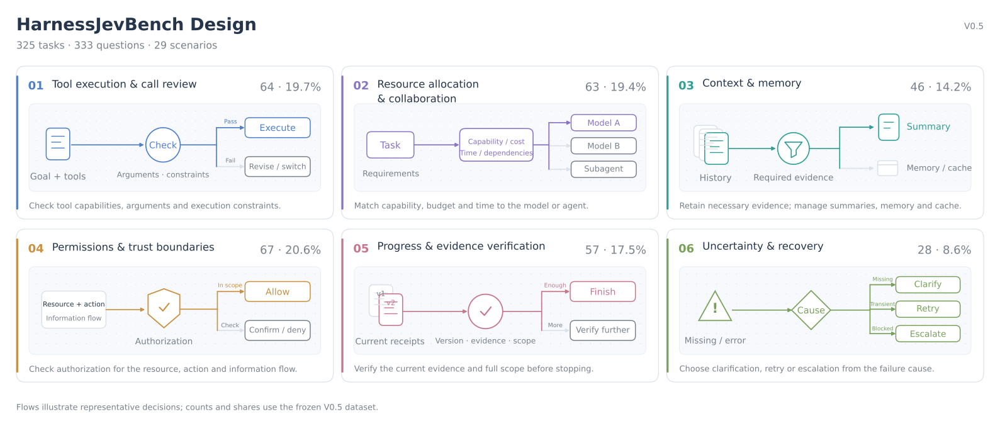

<h1 align="center">HarnessJevBench</h1>

<p align="center">
  <a href="README.md"><strong>English</strong></a> ·
  <a href="README.zh-CN.md">简体中文</a>
</p>

<p align="center">
  <a href="#quick-start"></a>
  <a href="#harnessjevbench-design"></a>
  <a href="results/leaderboard.json"></a>
  <a href="https://decisionplayground.agentscope.io/"></a>
  <a href="https://github.com/agentscope-ai"></a>
  <a href="https://github.com/agentscope-ai/OpenJudge"></a>
  <a href="LICENSE.md#benchmark-data--mit"></a>
</p>

<p align="center">
  <strong>A benchmark for Jev-style models at agent harness decision points.</strong><br>
  325 tasks · 333 questions · 29 scenarios
</p>

<p align="center">
  <a href="#harnessjevbench-design">Design</a> ·
  <a href="#results--leaderboard">Results</a> ·
  <a href="#quick-start">Quick Start</a> ·
  <a href="skills/harnessjevbench-eval/SKILL.md">Evaluation Skill</a> ·
  <a href="#contributing">Contributing</a> ·
  <a href="#citation">Citation</a>
</p>

---

**HarnessJevBench evaluates how existing Jev-style decision models perform at decision points in agent harnesses.**

Jev-style models take a supplied state and return choices and probabilities over candidate answers. To use them in a harness, we need to understand whether they can use runtime state, tool responses and execution constraints to select tools, allocate resources, check prerequisites, and decide when to continue or stop.

Developed by the [AgentScope](https://github.com/agentscope-ai) team, HarnessJevBench asks: **which harness decisions do existing Jev-style models handle well, and where do they still fail?** It selects decision environments around these control responsibilities and compares models on the same inputs and scoring rules, informing the choice of model and where to integrate it.

> [!NOTE]
> For agent trajectory, tool-use and response-quality evaluation, explore [OpenJudge](https://github.com/agentscope-ai/OpenJudge), our open-source framework for built-in and custom graders and quality rewards.

## HarnessJevBench Design

The design starts from the harness's control responsibilities: identify the decisions a model would make, fix the runtime conditions at those decision points, then evaluate its choices and probability distributions.

### Selecting decision environments

A decision environment is the runtime state, available actions and execution constraints presented at a control point. Scenarios are organized around three requirements:

- **Relevant to runtime control:** the decision affects tool calls, resource use, information retention, permissions or task progress.
- **Dependent on the current state:** the model must use available evidence, tool responses, budgets, authorization and prerequisites.
- **Verifiable answers:** supplied rules and evidence determine a reference answer, or explicit conditions determine a reference probability distribution.

### Scenario coverage

These requirements define coverage across six control responsibilities: tool execution, resource allocation, context management, authorization boundaries, completion checks and error recovery. They comprise **29 scenarios**. The released **V0.5** contains **325 tasks and 333 questions**; the figure shows each group's task count, dataset share and a representative decision flow.



<details>
<summary>Explore all 29 scenarios</summary>

| Responsibility | Scenario | Tasks | Share | Decision |
|---|---|---:|---:|---|
| Tool execution and call review | Tool selection | 16 | 4.9% | Which tool meets scope, cost and latency limits? |
| Tool execution and call review | Argument validation | 14 | 4.3% | Do arguments satisfy types, required fields and exclusions? |
| Tool execution and call review | Tool-call review | 13 | 4.0% | Execute the proposed call, correct it or meet a prerequisite? |
| Tool execution and call review | Browser action | 10 | 3.1% | Click, wait, refresh the page or clarify the target? |
| Tool execution and call review | Transactions and concurrency | 11 | 3.4% | Are snapshots and concurrent operations consistent? |
| Resource allocation and collaboration | Model routing | 14 | 4.3% | Which model meets capability, budget and latency needs? |
| Resource allocation and collaboration | Task budget | 16 | 4.9% | Can the next action fit failed-call and wrap-up costs? |
| Resource allocation and collaboration | Reasoning budget | 10 | 3.1% | How much reasoning do the constraints and risks need? |
| Resource allocation and collaboration | Subagent dispatch | 13 | 4.0% | Which agent meets skill, isolation and resource limits? |
| Resource allocation and collaboration | Delegation strategy | 10 | 3.1% | Which subtasks may run in parallel, and which must wait? |
| Context and memory | Context retention | 14 | 4.3% | Keep a full record, summarize it or drop a duplicate? |
| Context and memory | Context compression | 11 | 3.4% | Which summary preserves required evidence within budget? |
| Context and memory | Memory writes | 10 | 3.1% | Which information may be stored in long-term memory? |
| Context and memory | Cache validity | 11 | 3.4% | Do permission, dependency and expiry checks allow reuse? |
| Permissions and trust boundaries | Tool authorization | 17 | 5.2% | Is this actor authorized for this resource and action? |
| Permissions and trust boundaries | Browser confirmation | 11 | 3.4% | Is the navigation or page action authorized to proceed? |
| Permissions and trust boundaries | Execution risk | 8 | 2.5% | What risk tier follows from impact and reversibility? |
| Permissions and trust boundaries | Privacy of released data | 14 | 4.3% | Would the release expose individuals or a small group? |
| Permissions and trust boundaries | Sensitive-data egress | 9 | 2.8% | Does the transformed output still contain restricted data? |
| Permissions and trust boundaries | Untrusted-input boundaries | 8 | 2.5% | Which content is evidence, and which is not an instruction? |
| Progress and evidence verification | Next trajectory step | 7 | 2.2% | Advance from new receipts or avoid a duplicate action? |
| Progress and evidence verification | Plan progress | 10 | 3.1% | How far has the plan progressed based on verified outputs? |
| Progress and evidence verification | Completion scope | 11 | 3.4% | Has every item in the user-requested scope been checked? |
| Progress and evidence verification | Evidence for stopping | 9 | 2.8% | Are required receipts complete for this version and scope? |
| Progress and evidence verification | Version consistency | 10 | 3.1% | Does the action remain valid after a version or state change? |
| Progress and evidence verification | Retrieval evidence | 10 | 3.1% | Do sources match the entity, time window and independence? |
| Uncertainty and recovery | Clarification and abstention | 8 | 2.5% | Does missing information require clarification or deferral? |
| Uncertainty and recovery | Retry or escalate | 9 | 2.8% | Wait, check status, retry with the same key or escalate? |
| Uncertainty and recovery | Recovery action | 11 | 3.4% | Does the error call for backoff, a fix or a user question? |

Shares use all 325 tasks; two evaluation views of one distribution-reference task count once. Groups organize the display without changing scenario labels or scoring.

</details>

### Evaluation approach

Each task fixes the runtime state and conditions at a control point. Models answer independently on the same inputs, with reference answers kept outside model requests. This allows comparison of their decisions across control responsibilities.

Evaluation covers decisions with a definite reference answer and judgments with a reference probability distribution:

| Metric | What it measures | Size |
|---|---|---|
| **Decision Accuracy ↑** | Whether a model makes the correct decision when there is a definite reference answer | 295 tasks, 303 questions |
| **Distribution Distance (TV) ↓** | How closely predicted probabilities match reference distributions defined by the task | 30 tasks × 2 fixed views = 60 views |

Decision Accuracy averages correctness within each task, then equally across tasks. Distribution Distance uses total variation distance: 0 means an exact match, and smaller is better. Report the two metrics separately; they are not combined into an overall score.

These metrics help identify model integrations worth validating further. Task success, cost and latency after integration require evaluation in a running agent. See the [evaluation notes](skills/harnessjevbench-eval/references/reproducibility.md) for data and reproduction details.

## Results / Leaderboard

**[View the live leaderboard](https://decisionplayground.agentscope.io/)** and select HarnessJevBench. The table below is the published V0.5 snapshot: nine retained historical results and three Piccolo checkpoints evaluated on October 28, 2026.

| Rank | Model | Decision Accuracy ↑ | Distribution Distance (TV) ↓ |
|---:|---|---:|---:|
| 1 | vLLM-SR d3 (27B) | 82.37% | 0.184423 |
| 2 | Piccolo-27B | 82.03% | 0.182543 |
| 3 | StartLux-Decision v1.1 27B Instant | 81.36% | 0.181292 |
| 4 | Perplexity Decider v1.2 (27B) | 78.64% | 0.267630 |
| 5 | Mercury Decide (Inception) | 73.39% | 0.401628 |
| 6 | Piccolo-9B | 69.49% | 0.309599 |
| 7 | Piccolo-4B | 65.59% | 0.287272 |
| 8 | Jev 1.14 | 64.07% | 0.275505 |
| 9 | GPT-6 Luna Decisions | 61.19% | — |
| 10 | Microsoft Decision-1 | 60.85% | 0.404096 |
| 11 | Cloudflare Clef (27B) | 60.17% | 0.343940 |
| 12 | Strands Decider 26B-A4B (Gemma 4) | 55.93% | 0.312522 |

Ranked by Decision Accuracy. “—” indicates incomplete evaluation coverage for that metric.

## Quick Start

### Requirements

**Python 3.10+** is sufficient for scoring and HTTP inference; both use only the standard library. HTTP is the default and calls `/v1/systemone` without model dependencies. Optional in-process Python engines run in the model's own environment and load its repository implementation lazily. Download or clone this repository and run the commands below from its root.

### Deploy a Model Service

Runnable native wrappers and API gateways are included in [`examples/model-services/`](examples/model-services/). The [deployment guide](skills/harnessjevbench-eval/references/deployment.md) covers the historical ten-route examples, including the retired OneShot selector. `Piccolo-4B`, `Piccolo-9B` and `Piccolo-27B` require their model-owned runtime as an external dependency. Checkpoint identities for the published measurements are recorded in the [reproduction notes](skills/harnessjevbench-eval/references/reproducibility.md#model-names-and-checkpoint-identity).

For example, after setting `OPENROUTER_API_KEY`, start the Jev gateway in a service terminal:

```bash
cd examples/model-services
cp systemone_services/profiles.json profiles.local.json
python -m systemone_services --model JEV1.14 --config profiles.local.json --port 8006
```

Keep the service running. In another terminal, from the Benchmark repository root, prepare the client configuration:

```bash
cp configs/models.json configs/models.systemone.local.json
python -m evaluation verify
```

The local configuration is ignored by Git. The public template provides ten `/v1/systemone` routes; update their endpoint addresses, including any split overrides. Hosted-provider credentials belong on the gateway. If the wrapper itself needs authentication, set its client `key_env` variable or supply an existing private `--env-file`. Model owners configure weights, runtime and inference controls in their own service profiles.

### Run Evaluation

Check the selected model's configuration before calling it:

```bash
python -m evaluation doctor --model JEV1.14 --config configs/models.systemone.local.json
```

```bash
# Smoke test: two decision-accuracy tasks
python -m evaluation predict --model JEV1.14 --config configs/models.systemone.local.json \
  --split hard --limit 2 --output runs/jev-smoke

# Full evaluation: 295 decision-accuracy tasks and 60 distribution views
python -m evaluation predict --model JEV1.14 --config configs/models.systemone.local.json \
  --output runs/jev-full

# Evaluate another configured model
python -m evaluation predict --model microsoft/microsoft-decision-1 \
  --config configs/models.systemone.local.json --output runs/microsoft-full
```

`doctor` checks configuration without inference calls. **`predict` makes real model calls** and the provider may charge for them. Each run needs a new output directory. Use `--split hard` or `--split soft` for one phase and `--resume` to continue the same run with matching inputs and configuration. Existing records, including failures, remain in place when resuming.

See `python -m evaluation predict --help` for available flags and the [evaluation skill](skills/harnessjevbench-eval/SKILL.md) for all model profiles, prediction formats and scoring rules. The default client uses one HTTP contract for the ten-model roster; optional Python engines load model-owned implementations directly. The included model-service examples supply native wrappers and gateways. Use the [ten-model setup and usage examples](skills/harnessjevbench-eval/SKILL.md#ten-model-systemone-examples) and [client configuration](configs/models.json).

### Python In-Process Engine (optional)

Models can also expose a Python callable in their own repository. Set `engine` to `module:Class`; the runner constructs it with `**options` and calls it with `state` and `questions`. It returns `(response, raw_output)`, with the same answer format as HTTP. Model dependencies stay in that model's Python environment.

The included model-service examples also expose a native D3/Clef/Strands/Perplexity engine. Create an ignored `configs/models.python.local.json`:

```json
{
  "models": {
    "D3-Python": {
      "engine": "systemone_services.engine:NativeEngine",
      "model_id": "vllm-sr/d3",
      "module_paths": ["${D3_MODEL_REPO}"],
      "options": {"profile_path": "${D3_MODEL_PROFILES}", "model": "vllm-sr/d3"},
      "concurrency": 1
    }
  }
}
```

Set `D3_MODEL_REPO` to the absolute path of `examples/model-services/` and `D3_MODEL_PROFILES` to its configured `profiles.local.json`. With the matching model environment active, run from the Benchmark root:

```bash
python -m evaluation doctor --model D3-Python --config configs/models.python.local.json
CUDA_VISIBLE_DEVICES=0 python -m evaluation predict --model D3-Python \
  --config configs/models.python.local.json --output runs/d3-python-full
```

No HTTP server is needed for this route. Python calls are serial and have no automatic retry or hard timeout. The runner reuses a matching loaded engine across splits, calls its optional `close()` on exit, and records source/revision fingerprints for resume. The existing HTTP roster remains the default. See [Python engine contracts and examples](skills/harnessjevbench-eval/SKILL.md#python-in-process-engines-optional) for lifecycle, raw-output and deployment details.

### Evaluation Outputs

Inspect your own evaluation in the directory selected by `--output`:

- `scores-hard.json` and `scores-soft.json`: scores and valid coverage.
- `status.json`: execution status and progress.

Metric definitions are in [HarnessJevBench Design](#harnessjevbench-design).

The same directory contains `protocol.json`, `receipts.jsonl`, `predictions-hard.jsonl`, `predictions-soft.jsonl` and `service-identities.json` for checking the run configuration, raw responses, predictions and engine identity.

<details>
<summary>Recompute the published scores without model calls</summary>

```bash
python -m evaluation replay --predictions /path/to/predictions.jsonl --output runs/replay-example
```

First download and extract the separately distributed `HarnessJevBench-predictions-v0.5-piccolo.zip`, then replace `/path/to/predictions.jsonl` with its extracted prediction file. Replay recomputes all twelve rows and checks scores and coverage against `results/leaderboard.json`, without calling models. The historical predictions are optional and are not included in the source package.

</details>

<details>
<summary>Export inputs and score answers from your own adapter</summary>

```bash
python -m evaluation export --split hard --output runs/hard-inputs.jsonl
python -m evaluation export --split soft --soft-views --output runs/soft-inputs.jsonl
python -m evaluation score --split hard --predictions my-hard.jsonl --output runs/hard.json
python -m evaluation score --split soft --soft-views --predictions my-soft.jsonl --output runs/soft.json
```

Send only `state` and `questions` to the model. Keep task/view identifiers locally to match responses. Labels and construction metadata must not enter model requests. The [prediction contract](skills/harnessjevbench-eval/SKILL.md#prediction-contracts) specifies the answer format.

</details>

## Contributing

We welcome contributions that improve the coverage, reproducibility and diagnosis of harness control decisions.

| Contribution | What to provide |
|---|---|
| Model integration | A model-owned `/v1/systemone` service or external Python engine, upstream revision, runtime requirements, inference controls and normalized answers |
| Task proposals | Runtime state, visible rules, scenario, question, reference-answer derivation and a counterexample or answer-changing variation where applicable |
| New results | Redacted configuration, measurement date, protocol, predictions, phase scores and valid/expected coverage |
| Reference or scorer issues | Task/question ID, the rule or evidence involved, a reproducible example and the expected behavior |
| Evaluation improvements | Clearer instructions, deployment examples, failure analysis or reproducibility fixes |

Useful first contributions include checking a reference answer, reproducing a failed decision, or evaluating a new decision model. Propose changes through repository issues or pull requests. Keep V0.5 task content frozen; task corrections and additions should be reviewed for a new content version. Check response receipts for private content before sharing, and never submit API keys or local deployment credentials.

Run the existing checks before sharing a change:

```bash
python -m unittest discover -s tests -v
python -m evaluation verify
```

Include the model revision, runtime configuration and coverage with new results. See the [evaluation skill](skills/harnessjevbench-eval/SKILL.md) for the reporting contract.

## Citation

Please cite HarnessJevBench when reporting results:

```bibtex
@misc{harnessjevbench,
  title  = {HarnessJevBench: Evaluating Runtime Control Decisions in Agent Harnesses},
  author = {{AgentScope Team}},
  url    = {https://decisionplayground.agentscope.io/},
  month  = {10},
  year   = {2026},
  note   = {Benchmark V0.5}
}
```

Benchmark **V0.5** · Data license: [MIT](LICENSE.md#benchmark-data--mit)
