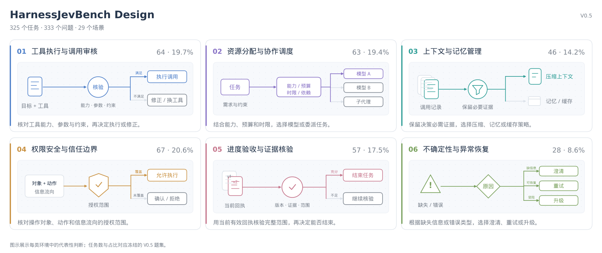

<h1 align="center">HarnessJevBench</h1>

<p align="center">
  <a href="README.md">English</a> ·
  <a href="README.zh-CN.md"><strong>简体中文</strong></a>
</p>

<p align="center">
  <a href="#quick-start"></a>
  <a href="#harnessjevbench-design"></a>
  <a href="results/leaderboard.json"></a>
  <a href="https://decisionplayground.agentscope.io/"></a>
  <a href="https://github.com/agentscope-ai"></a>
  <a href="https://github.com/agentscope-ai/OpenJudge"></a>
  <a href="LICENSE.md#benchmark-data--mit"></a>
</p>

<p align="center">
  <strong>评测 Jev 类模型在智能体 Harness 中的运行控制决策。</strong><br>
  325 个任务 · 333 个问题 · 29 个场景
</p>

<p align="center">
  <a href="#harnessjevbench-design">Design</a> ·
  <a href="#results--leaderboard">Results</a> ·
  <a href="#quick-start">Quick Start</a> ·
  <a href="skills/harnessjevbench-eval/SKILL.md">评测 Skill</a> ·
  <a href="#contributing">Contributing</a> ·
  <a href="#citation">Citation</a>
</p>

---

**HarnessJevBench 用于评测现有 Jev 类决策模型在智能体 Harness 决策环节中的表现。**

Jev 类模型可以根据给定状态，为候选动作或判断输出选择与概率。将它们接入 Harness，需要了解模型能否依据运行状态、工具回执和执行约束，选对工具、分配资源、检查执行条件，以及判断何时继续或结束任务。

[AgentScope](https://github.com/agentscope-ai) 团队构建 HarnessJevBench，希望回答：**现有 Jev 类模型在哪些 Harness 决策环节表现较好，哪些环节仍容易出错？** Benchmark 围绕这些控制判断选择决策环境，在相同输入和评分规则下比较模型，为选择模型及其接入环节提供依据。

> [!NOTE]
> 如需评估智能体轨迹、工具调用与回答质量，或构建自定义评测器和质量奖励信号，欢迎使用我们团队的 [OpenJudge](https://github.com/agentscope-ai/OpenJudge) 开源框架。

## HarnessJevBench Design

设计从 Harness 的控制职责出发：先确定模型需要参与哪些判断，再固定判断发生时的运行条件，最后评测决策及其概率分布。

### 决策环境的选择

这里的决策环境，是模型作出一次控制判断时面对的运行状态、可选动作和执行约束。场景围绕三项要求组织：

- **与运行控制相关**：判断会影响工具调用、资源使用、信息保留、操作权限或任务推进。
- **依赖当前状态**：需要结合已有证据、工具回执、预算、授权和前置条件作出选择。
- **答案可以核验**：能够依据给定规则与证据确定参考答案，或依据明确条件确定参考概率分布。

### 场景覆盖

据此，Benchmark 覆盖工具执行、资源调度、上下文管理、权限边界、完成验收与异常恢复六类控制职责，并细分为 **29 个场景**。当前 **V0.5** 包含 **325 个任务、333 个问题**；下图展示各类职责的任务数量、占比与典型判断流程。



<details>
<summary>查看全部 29 个场景</summary>

| 所属职责 | 场景 | 任务数 | 占比 | 判断内容 |
|---|---|---:|---:|---|
| 工具执行与调用审核 | 工具执行器选择 | 16 | 4.9% | 选择满足范围、费用和时延约束的工具 |
| 工具执行与调用审核 | 参数契约校验 | 14 | 4.3% | 参数是否满足类型、必填与互斥规则？ |
| 工具执行与调用审核 | 调用与用户目标一致性 | 13 | 4.0% | 拟议调用能否执行，还是要先修正？ |
| 工具执行与调用审核 | 浏览器下一步动作 | 10 | 3.1% | 应点击、等待、刷新，还是澄清目标？ |
| 工具执行与调用审核 | 事务与并发 | 11 | 3.4% | 读取快照与并发操作是否满足一致性？ |
| 资源分配与协作调度 | 模型路由 | 14 | 4.3% | 哪个模型满足能力、预算与时延要求？ |
| 资源分配与协作调度 | 任务预算分配 | 16 | 4.9% | 计入失败与收尾费用后，预算是否足够？ |
| 资源分配与协作调度 | 推理预算 | 10 | 3.1% | 按约束数量与风险，需要多少推理投入？ |
| 资源分配与协作调度 | 子代理派发 | 13 | 4.0% | 哪个代理满足技能、隔离与资源条件？ |
| 资源分配与协作调度 | 任务委派策略 | 10 | 3.1% | 哪些子任务可并行，哪些必须顺序执行？ |
| 上下文与记忆管理 | 上下文证据保留 | 14 | 4.3% | 哪些调用记录要完整保留、压缩或删除？ |
| 上下文与记忆管理 | 上下文压缩计划 | 11 | 3.4% | 哪份压缩方案保留必要证据且满足预算？ |
| 上下文与记忆管理 | 长期记忆写入 | 10 | 3.1% | 哪些信息允许写入长期记忆？ |
| 上下文与记忆管理 | 缓存有效性 | 11 | 3.4% | 权限、依赖与时效是否仍支持复用缓存？ |
| 权限安全与信任边界 | 工具授权范围 | 17 | 5.2% | 当前主体对该资源和动作是否获授权？ |
| 权限安全与信任边界 | 浏览器操作确认 | 11 | 3.4% | 这次导航或页面操作是否需要用户确认？ |
| 权限安全与信任边界 | 执行风险关卡 | 8 | 2.5% | 按影响与可逆性，操作属于哪个风险等级？ |
| 权限安全与信任边界 | 数据发布授权 | 14 | 4.3% | 发布结果是否泄露个体或可反推的小群体？ |
| 权限安全与信任边界 | 敏感信息外发 | 9 | 2.8% | 转换后的结果是否仍含禁止外发的信息？ |
| 权限安全与信任边界 | 不可信输入边界 | 8 | 2.5% | 哪些内容可作证据，哪些不能当作指令？ |
| 进度验收与证据核验 | 轨迹下一步 | 7 | 2.2% | 根据最新回执，应继续推进还是避免重复？ |
| 进度验收与证据核验 | 计划进度 | 10 | 3.1% | 依据可核验产物，计划实际完成到哪一步？ |
| 进度验收与证据核验 | 完成范围核验 | 11 | 3.4% | 用户要求的全部范围是否已核验完成？ |
| 进度验收与证据核验 | 终止证据 | 9 | 2.8% | 当前版本与目标范围的验收回执是否齐全？ |
| 进度验收与证据核验 | 版本与环境一致性 | 10 | 3.1% | 版本或环境变化后，原操作是否仍然适用？ |
| 进度验收与证据核验 | 检索证据质量 | 10 | 3.1% | 证据是否匹配主体、时段并有独立来源？ |
| 不确定性与异常恢复 | 澄清与暂缓 | 8 | 2.5% | 信息缺失时，是否需要先澄清或暂缓？ |
| 不确定性与异常恢复 | 重试或升级 | 9 | 2.8% | 应等待、查状态、同键重试，还是升级处理？ |
| 不确定性与异常恢复 | 异常恢复动作 | 11 | 3.4% | 按错误类型，应退避、修参还是询问用户？ |

占比以全部 325 个任务为分母；同一分布参考任务的两个视图只计一个任务。六类职责用于组织展示，不改变原有场景标签与评分方式。

</details>

### 评测方式

每个任务固定一个控制点上的运行状态和判断条件。不同模型在相同输入下独立作答，参考答案保存在模型输入之外；由此比较它们在各类控制环节中的决策表现。

评测分别考察有明确参考答案的决策，以及以概率分布为参考答案的判断：

| 指标 | 评测内容 | 规模 |
|---|---|---|
| **Decision Accuracy / 决策准确率 ↑** | 有明确参考答案时，模型能否依据规则和证据作出正确决策 | 295 个任务，303 个问题 |
| **Distribution Distance / 概率分布距离（TV）↓** | 模型预测的概率分布与题目定义的参考分布有多接近 | 30 个任务 × 2 个固定视图，共 60 个视图 |

决策准确率先计算任务内的问题平均分，再对任务等权平均；概率分布距离采用 TV 距离，0 表示完全一致，越低越好。两项指标分别报告，不合成总分。

这些指标帮助识别模型适合进一步验证的接入环节。实际接入后的任务成功率、成本与时延，需要在智能体运行中继续验证。数据与复现说明见[评测参考资料](skills/harnessjevbench-eval/references/reproducibility.md)。

## Results / Leaderboard

本表保留其余九个模型的历史成绩，新增 2026 年 10 月 28 日实际推理得到的三个 Piccolo checkpoint 成绩。

**[查看最新在线榜单](https://decisionplayground.agentscope.io/)**，选择 HarnessJevBench。下表为已披露的 V0.5 成绩快照。

| 排名 | 模型 | Decision Accuracy ↑ | Distribution Distance (TV) ↓ |
|---:|---|---:|---:|
| 1 | vLLM-SR d3 (27B) | 82.37% | 0.184423 |
| 2 | Piccolo-27B | 82.03% | 0.182543 |
| 3 | StartLux-Decision v1.1 27B Instant | 81.36% | 0.181292 |
| 4 | Perplexity Decider v1.2 (27B) | 78.64% | 0.267630 |
| 5 | Mercury Decide (Inception) | 73.39% | 0.401628 |
| 6 | Piccolo-9B | 69.49% | 0.309599 |
| 7 | Piccolo-4B | 65.59% | 0.287272 |
| 8 | Jev 1.14 | 64.07% | 0.275505 |
| 9 | GPT-6 Luna Decisions | 61.19% | — |
| 10 | Microsoft Decision-1 | 60.85% | 0.404096 |
| 11 | Cloudflare Clef (27B) | 60.17% | 0.343940 |
| 12 | Strands Decider 26B-A4B (Gemma 4) | 55.93% | 0.312522 |

按决策准确率排序。“—”表示该项评测覆盖不完整。

## Quick Start

### Requirements

**Python 3.10+** 即可运行评分和 HTTP 推理，两者只依赖标准库。默认 HTTP 模式调用 `/v1/systemone`，无需安装模型依赖；可选 Python 模式在模型自身环境中延迟加载其仓库实现。下载或克隆仓库后，在仓库根目录执行以下命令。

### Deploy a Model Service

仓库的 [`examples/model-services/`](examples/model-services/) 提供可运行的原生模型包装服务和 API 网关。[部署指南](skills/harnessjevbench-eval/references/deployment.md)说明历史十个路由的权重、环境与启动命令，其中保留已退出榜单的 OneShot 兼容入口。`Piccolo-4B`、`Piccolo-9B` 和 `Piccolo-27B` 所需的模型侧运行时是独立的外部依赖，已发布成绩的 checkpoint 来源见[复现说明](skills/harnessjevbench-eval/references/reproducibility.md#model-names-and-checkpoint-identity)。

例如，设置 `OPENROUTER_API_KEY` 后，在服务终端启动 Jev 网关：

```bash
cd examples/model-services
cp systemone_services/profiles.json profiles.local.json
python -m systemone_services --model JEV1.14 --config profiles.local.json --port 8006
```

保持服务运行，在另一个终端回到 Benchmark 仓库根目录，准备客户端配置：

```bash
cp configs/models.json configs/models.systemone.local.json
python -m evaluation verify
```

本机配置已被 Git 忽略。公开模板提供十模型的统一端点；按部署环境修改地址及分组覆盖项。服务端负责权重、源码路径与推理参数，托管提供方密钥留在网关；如果网关自身需要鉴权，在客户端配置 `key_env`，通过环境变量或现有私有 `--env-file` 提供密钥。

### Run Evaluation

先检查所选模型配置：

```bash
python -m evaluation doctor --model JEV1.14 --config configs/models.systemone.local.json
```

```bash
# 冒烟：两个决策准确率任务
python -m evaluation predict --model JEV1.14 --config configs/models.systemone.local.json \
  --split hard --limit 2 --output runs/jev-smoke

# 全量：295 个决策准确率任务和 60 个分布视图，推理后自动评分
python -m evaluation predict --model JEV1.14 --config configs/models.systemone.local.json \
  --output runs/jev-full

# 评测另一个已配置模型
python -m evaluation predict --model microsoft/microsoft-decision-1 \
  --config configs/models.systemone.local.json --output runs/microsoft-full
```

`doctor` 检查配置，不发送推理请求。**`predict` 会真实调用模型**，服务提供方可能收费。每次运行使用新的输出目录；`--split hard` 或 `--split soft` 选择单个分组，`--resume` 在输入与配置匹配时续跑同一轮实验。续跑保留已有记录，包括失败记录。

完整参数见 `python -m evaluation predict --help`。十模型接入、预测格式和计分约束见[评测 Skill](skills/harnessjevbench-eval/SKILL.md)。统一 Engine 默认走 HTTP，也可加载模型仓库中的 Python 进程内引擎；模型加载、GPU 选择和概率读取仍由模型实现负责。单独提供的 `systemone_services` 接入包包含原生包装与网关。启动步骤与[十模型使用示例](skills/harnessjevbench-eval/SKILL.md#ten-model-systemone-examples)见 Skill，[统一配置](configs/models.json)为仓库唯一公开客户端模板。

### Python In-Process Engine（可选）

也可以直接加载模型仓库中的 Python 引擎。配置 `engine=module:Class` 后，评测程序用 `**options` 构造引擎，仅传入 `state`、`questions`，接收 `(response, raw_output)`。回答格式与 HTTP 一致，模型依赖由其自身 Python 环境提供。

仓库中的模型服务示例也提供 D3、Clef、Strands、Perplexity 的原生进程内引擎。创建被 Git 忽略的 `configs/models.python.local.json`：

```json
{
  "models": {
    "D3-Python": {
      "engine": "systemone_services.engine:NativeEngine",
      "model_id": "vllm-sr/d3",
      "module_paths": ["${D3_MODEL_REPO}"],
      "options": {"profile_path": "${D3_MODEL_PROFILES}", "model": "vllm-sr/d3"},
      "concurrency": 1
    }
  }
}
```

`D3_MODEL_REPO` 指向 `examples/model-services/` 的绝对路径，`D3_MODEL_PROFILES` 指向其中配置好的 `profiles.local.json`。激活匹配的模型环境后，在 Benchmark 根目录执行：

```bash
python -m evaluation doctor --model D3-Python --config configs/models.python.local.json
CUDA_VISIBLE_DEVICES=0 python -m evaluation predict --model D3-Python \
  --config configs/models.python.local.json --output runs/d3-python-full
```

此方式无需启动 HTTP 服务。Python 调用保持串行，不自动重试或施加硬超时；相同配置跨两个评测子集复用已加载模型，退出时调用可选的 `close()`，并记录源码及版本指纹用于续跑核对。现有十模型 HTTP 配置继续作为默认入口。完整接口、原始输出格式及生命周期说明见[Python 引擎使用示例](skills/harnessjevbench-eval/SKILL.md#python-in-process-engines-optional)。

### Evaluation Outputs

在 `--output` 指定的目录中查看本次评测输出：

- `scores-hard.json`、`scores-soft.json`：分数与有效覆盖数。
- `status.json`：执行状态和进度。

指标定义见 [HarnessJevBench Design](#harnessjevbench-design)。

同目录保存 `protocol.json`、`receipts.jsonl`、`predictions-hard.jsonl`、`predictions-soft.jsonl` 和 `service-identities.json`，用于核对运行配置、原始响应、模型作答与引擎身份。

<details>
<summary>不调用模型，复算已披露成绩</summary>

```bash
python -m evaluation replay --predictions /path/to/predictions.jsonl --output runs/replay-example
```

先下载并解压单独提供的 `HarnessJevBench-predictions-v0.5-piccolo.zip`，将 `/path/to/predictions.jsonl` 替换为解压后的预测文件路径。复算重新计算十二模型成绩，并与 `results/leaderboard.json` 核对分数和覆盖率，不调用模型。历史预测为可选材料，不包含在源码包中。

</details>

<details>
<summary>导出题目，并评分自有适配器生成的答案</summary>

```bash
python -m evaluation export --split hard --output runs/hard-inputs.jsonl
python -m evaluation export --split soft --soft-views --output runs/soft-inputs.jsonl
python -m evaluation score --split hard --predictions my-hard.jsonl --output runs/hard.json
python -m evaluation score --split soft --soft-views --predictions my-soft.jsonl --output runs/soft.json
```

仅向模型发送 `state` 与 `questions`，任务和视图标识留在本地匹配答案。标签及构建元数据不进入推理请求。回答格式见[预测契约](skills/harnessjevbench-eval/SKILL.md#prediction-contracts)。

</details>

## Contributing

欢迎社区共同改进 Harness 控制决策的覆盖、复现与诊断能力。

| 贡献方向 | 提交内容 |
|---|---|
| 模型接入 | 模型仓库中的 `/v1/systemone` 服务或 Python 引擎、上游版本、环境要求、推理参数和标准化回答 |
| 任务提案 | 运行状态、可见规则、场景、问题、参考答案推导，以及适用时的反例或改变答案的变体 |
| 新评测结果 | 去除密钥的配置、测量日期、协议、模型答案、分组成绩与有效/预期覆盖数 |
| 参考答案或评分问题 | task/question ID、相关规则与证据、可复现样例和预期行为 |
| 评测体验改进 | 更清晰的说明、部署示例、失败分析或复现修复 |

可以从核对一道参考答案、复现一次失败决策或评测一个新模型开始，通过仓库 Issue 或 PR 提出改进。V0.5 题目内容保持冻结，题目纠错与新增任务应评审后纳入新内容版本。分享回执前检查私有内容，不提交 API 密钥或本机部署凭据。

提交仓库变更前执行现有检查：

```bash
python -m unittest discover -s tests -v
python -m evaluation verify
```

提交新成绩时注明模型版本、运行配置和覆盖率。完整报告要求见[评测 Skill](skills/harnessjevbench-eval/SKILL.md)。

## Citation

研究或项目使用 HarnessJevBench 时，可按以下方式引用：

```bibtex
@misc{harnessjevbench,
  title  = {HarnessJevBench: Evaluating Runtime Control Decisions in Agent Harnesses},
  author = {{AgentScope Team}},
  url    = {https://decisionplayground.agentscope.io/},
  month  = {10},
  year   = {2026},
  note   = {Benchmark V0.5}
}
```

Benchmark **V0.5** · 数据许可证：[MIT](LICENSE.md#benchmark-data--mit)
